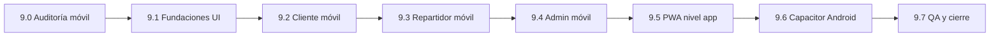

# 🎨 Roadmap Definitivo — Delivery Frontend (Multi-Rol: Cliente, Repartidor y Admin)

Guía arquitectónica y de implementación ordenada **fase por fase** para construir el Frontend completo de la plataforma **App Delivery**, conectando el **100% de los módulos, endpoints y WebSockets** construidos en las Fases 0 a 6 del Backend (`delivery-backend`) bajo los estándares de diseño de **`ui-ux-pro-max`**.

> [!IMPORTANT]
> **Estrategia del Proyecto:** Antes de ejecutar las fases finales de **Despliegue en AWS (ECS Fargate)** y **Kubernetes (K8s)**, completaremos la **FASE 9 (Frontend Mobile: Responsive Mobile-First, PWA Instalable y App Nativa con Capacitor)** para desplegar en infraestructura Cloud el ecosistema completo (Backend + Web + Mobile) integrado de extremo a extremo.

---

## 📍 Punto de Partida (Lo que ya tenemos en el Backend)

- ✅ **API RESTful en NestJS 11 (`http://localhost:3000/api/v1`)** con contrato global `{ success: true, data, timestamp }` (`TransformInterceptor`) y errores trazables con `requestId` (`HttpExceptionFilter`).
- ✅ **Autenticación y Seguridad:** JWT (`accessToken` 15m + `refreshToken` 7d con rotación), RBAC (`CLIENT`, `DELIVERY`, `ADMIN`), `OwnershipGuard`, `Throttle` y recuperación de contraseña.
- ✅ **16 Módulos Operativos:** `auth`, `users`, `categories`, `products`, `cart`, `orders`, `addresses`, `uploads` (AWS S3), `payments` (MercadoPago), `mail` (Nodemailer), `notifications` (Firebase FCM), `delivery`, `events` (Socket.io), `reviews`, `coupons`, `queues` (BullMQ + Redis) y `analytics`.
- ✅ **Caché y Tiempo Real:** Redis en categorías/productos y `EventsGateway` emitiendo `order_status_updated` y `delivery_location_updated`.

---

## 🛠️ Stack Tecnológico del Frontend (`delivery-frontend/`)

| Capa | Tecnología | Justificación Técnica |
|------|------------|-----------------------|
| **Core & Build** | **React 18+ · TypeScript · Vite** | Arranque instantáneo con HMR, tipado estricto de punta a punta con los DTOs del backend. |
| **Estilos & Sistema UI** | **Tailwind CSS · shadcn/ui (Radix) · Lucide React** | Componentes accesibles (WAI-ARIA), soporte nativo Light/Dark Mode e íconos vectoriales consistentes (**0 emojis como íconos**). |
| **Animaciones** | **Framer Motion** | Micro-interacciones fluidas (`150-300ms`), transiciones del Drawer del carrito y stepper de pedidos en vivo. |
| **Enrutamiento** | **React Router v6/v7** | Rutas anidadas, carga diferida (`lazy`) y Guards de protección por rol (`CLIENT`, `DELIVERY`, `ADMIN`). |
| **Estado del Servidor** | **TanStack Query (React Query v5) + Axios** | Caché inteligente en cliente, *Optimistic Updates* en el carrito, revalidación automática e interceptores JWT con *Silent Refresh*. |
| **Estado Global Cliente** | **Zustand** | Estado ligero y persistido para la sesión de usuario, dirección de entrega activa, UI del carrito y tema visual. |
| **Formularios & Validación** | **React Hook Form + Zod** | Validación reactiva sin re-renders innecesarios, replicando las reglas de `class-validator` del backend. |
| **Tiempo Real & Push** | **Socket.io-client · Firebase Web SDK (FCM)** | Conexión persistente con `EventsGateway` para tracking en vivo y recepción de notificaciones push en el navegador. |
| **Mapas & Geolocalización** | **Leaflet + React-Leaflet (OpenStreetMap)** | Selección de coordenadas de entrega, visualización de ruta y movimiento del repartidor en tiempo real sin costos de licencia. |
| **Visualización de Datos** | **Recharts** | Gráficos interactivos y responsivos para el módulo `/analytics` del panel de administración. |
| **Testing & Calidad** | **Vitest · Testing Library · Playwright** | Pruebas unitarias de componentes/hooks y pruebas E2E de los flujos críticos de los 3 roles. |

---

## 🎭 Sistema de Diseño Oficial (`ui-ux-pro-max`)

Siguiendo las directrices de la habilidad **`ui-ux-pro-max`**, la aplicación combina **dos lenguajes visuales complementarios** bajo una misma identidad de marca:
1. **Vibrant & Appetizing Bento (Marketplace Cliente):** Fotografías gastronómicas protagonistas, tarjetas con bordes suaves (`rounded-2xl`), sombras cálidas sutiles y micro-animaciones al agregar al carrito.
2. **Clean High-Contrast Glassmorphism (Rider App & Admin Dashboard):** Claridad operativa, indicadores de estado semánticos de alto contraste (`WCAG AA/AAA`), mapas a pantalla completa y paneles de métricas estilo *Bento Grid*.

### 🎨 Paleta de Colores Semántica

| Rol Semántico | Light Mode | Dark Mode | Uso en la Plataforma |
|---------------|------------|-----------|----------------------|
| **Primary (Brand / Appetizing)** | `#EA580C` (`orange-600`) | `#F97316` (`orange-500`) | CTAs principales ("Agregar al carrito", "Pagar"), badges destacados y marca. |
| **Primary Accent (Crimson)** | `#DC2626` (`red-600`) | `#EF4444` (`red-500`) | Descuentos, ofertas relámpago y alertas de urgencia. |
| **Secondary (Live Tracking)** | `#2563EB` (`blue-600`) | `#3B82F6` (`blue-500`) | Rutas en mapa, estado `OUT_FOR_DELIVERY`, interfaz de navegación del repartidor. |
| **Success (Delivered / Online)** | `#16A34A` (`green-600`) | `#22C55E` (`green-500`) | Estado `DELIVERED`, cupón aplicado, repartidor "Disponible / En línea". |
| **Warning (Rating / Kitchen)** | `#D97706` (`amber-600`) | `#F59E0B` (`amber-500`) | Estrellas de reseñas (`1-5`), estado `PREPARING` / `PENDING`. |
| **Background / Surface** | `#F8FAFC` / `#FFFFFF` | `#020617` / `#0F172A` | Fondos generales (`Slate-50`/`Slate-950`) y tarjetas (`White`/`Slate-900`). |
| **Text Primary / Muted** | `#0F172A` / `#475569` | `#F8FAFC` / `#94A3B8` | Contraste mínimo garantizado > 4.5:1 (cuerpo) y > 7:1 (títulos). |

### 🔤 Tipografía (`Google Fonts`)
- **Headings (`Outfit`):** Geométrica, moderna y con personalidad para títulos de secciones, nombres de platos, precios y KPIs (`font-semibold` / `font-bold`, `tracking-tight`).
- **Body (`Plus Jakarta Sans` / `Nunito Sans`):** Legibilidad óptima en descripciones de ingredientes, direcciones, tablas de órdenes y formularios.

### 📏 Checklist de Reglas de Oro (`ui-ux-pro-max`)
- **Prohibido usar emojis como íconos de UI:** Usar exclusivamente `lucide-react` con tamaño y trazo consistentes (`w-5 h-5`, `strokeWidth={1.75}`).
- **Cero Layout Shift (CLS = 0):** Todas las imágenes de productos/categorías deben tener `aspect-ratio` fijo (`aspect-square` o `aspect-[4/3]`) y `Skeleton` mientras cargan desde S3/CloudFront.
- **Feedback Interactivo Obligatorio:** `cursor-pointer` en todo elemento clicable, transiciones suaves (`transition-all duration-200`) y estados `:focus-visible` claros para accesibilidad por teclado.

---

## 🏗️ Arquitectura de Carpetas (`delivery-frontend/`)

```text
delivery-frontend/
├── public/
│   ├── manifest.json                   # Configuración PWA instalable
│   └── firebase-messaging-sw.js        # Service Worker para Push Notifications (FCM)
├── src/
│   ├── api/
│   │   ├── axios.client.ts             # Instancia Axios + desenvoltura TransformInterceptor + Refresh Token Queue
│   │   └── endpoints/                  # Clientes tipados por módulo del backend (13 servicios)
│   │       ├── auth.api.ts
│   │       ├── users.api.ts
│   │       ├── categories.api.ts
│   │       ├── products.api.ts
│   │       ├── cart.api.ts
│   │       ├── addresses.api.ts
│   │       ├── coupons.api.ts
│   │       ├── orders.api.ts
│   │       ├── payments.api.ts
│   │       ├── reviews.api.ts
│   │       ├── delivery.api.ts
│   │       ├── uploads.api.ts
│   │       └── analytics.api.ts
│   ├── types/                          # Interfaces TypeScript espejo de los Schemas/DTOs de NestJS
│   │   ├── api.types.ts                # ApiResponse<T>, PaginatedResponse<T>, ApiError
│   │   ├── auth.types.ts
│   │   ├── catalog.types.ts
│   │   ├── order.types.ts
│   │   ├── delivery.types.ts
│   │   └── analytics.types.ts
│   ├── store/                          # Estado global ligero con Zustand
│   │   ├── useAuthStore.ts             # Usuario activo, tokens, rol y permisos
│   │   ├── useCartDrawerStore.ts       # Control de apertura/cierre del carrito y dirección activa
│   │   └── useThemeStore.ts            # Light / Dark / System mode
│   ├── hooks/                          # Custom Hooks (TanStack Query + WebSockets + Geolocation)
│   │   ├── queries/                    # useProducts, useCategories, useCart, useOrders, useAnalytics...
│   │   ├── useSocket.ts                # Conexión autenticada con EventsGateway (Socket.io)
│   │   ├── useGeolocation.ts           # Tracking GPS del repartidor (real + simulador)
│   │   └── useDebounce.ts              # Búsqueda instantánea sin saturar la API
│   ├── components/
│   │   ├── ui/                         # Design System base (Button, Input, Badge, Modal, Drawer, Skeleton, Toast)
│   │   ├── layout/                     # Navbar, BottomNav móvil, Sidebar Admin, ThemeToggle, AddressSelector
│   │   ├── catalog/                    # ProductCard, CategoryPills, ProductFilters, ProductDetailModal
│   │   ├── cart/                       # CartDrawer, CartItemRow, CouponInputBox, OrderSummaryCard
│   │   ├── orders/                     # OrderStatusStepper, LiveTrackingMap, OrderCard, ReviewFormModal
│   │   ├── delivery/                   # AvailabilitySwitch, AvailableOrderCard, ActiveDeliveryMap, RiderStatsBento
│   │   └── admin/                      # KpiBentoGrid, SalesChart, TopProductsTable, ImageDropzoneS3, OrderKanban
│   ├── pages/
│   │   ├── auth/                       # LoginPage, RegisterPage, ForgotPasswordPage, ResetPasswordPage
│   │   ├── client/                     # HomePage, CatalogPage, CheckoutPage, PaymentResultPage, MyOrdersPage, OrderTrackingPage, ProfilePage
│   │   ├── delivery/                   # RiderOnboardingPage, RiderDashboardPage, ActiveDeliveryPage, RiderStatsPage
│   │   └── admin/                      # AdminAnalyticsPage, AdminOrdersPage, AdminProductsPage, AdminCategoriesPage, AdminCouponsPage, AdminUsersPage
│   ├── routes/
│   │   ├── AppRouter.tsx               # Definición de rutas con Code Splitting (React.lazy)
│   │   ├── ProtectedRoute.tsx          # Verifica sesión JWT válida
│   │   └── RoleGuard.tsx               # Restringe rutas por Role ('CLIENT' | 'DELIVERY' | 'ADMIN')
│   └── utils/
│       ├── cn.ts                       # clsx + tailwind-merge
│       ├── formatters.ts               # Moneda (COP/USD), fechas relativas y distancias (km)
│       └── sound.ts                    # Alertas sonoras sintetizadas (Web Audio API) para nuevos estados/pedidos
├── tests/                              # Suites de pruebas Unitarias (Vitest) y E2E (Playwright)
├── Dockerfile                          # Multi-stage (Node 20 build -> Nginx Alpine)
└── .env.example                        # Variables VITE_API_URL, VITE_WS_URL, VITE_FIREBASE_*
```

---

## 🔧 FASE 0 — Arquitectura Base, Design System (`ui-ux-pro-max`) y Cliente HTTP
**Duración estimada:** 1 semana  
**Objetivo:** Levantar los cimientos técnicos del frontend, el sistema de diseño visual y la capa de comunicación blindada con el backend de NestJS.

### Tareas de la Fase 0

| # | Tarea | Detalle Técnico |
|---|-------|-----------------|
| 1 | **Inicializar Proyecto Vite + TS** | Crear `delivery-frontend/` con `React 18+`, `TypeScript` estricto y configurar alias de importación `@/*` hacia `./src/*`. |
| 2 | **Configurar Tailwind + Tokens `ui-ux-pro-max`** | Configurar fuentes (`Outfit` y `Plus Jakarta Sans`), variables CSS para Light/Dark Mode, paleta semántica y utilidades `clsx` + `tailwind-merge` (`cn.ts`). |
| 3 | **Contratos Globales TypeScript (`api.types.ts`)** | Tipar la respuesta estándar del `TransformInterceptor` (`{ success: boolean; data: T; timestamp: string }`), la interfaz `PaginatedResponse<T>` (`data` + `meta: { total, page, lastPage }`) y el formato de error de `HttpExceptionFilter` (`requestId`, `statusCode`, `message`). |
| 4 | **Cliente Axios + Silent Refresh Queue** | Crear `axios.client.ts` con `baseURL: import.meta.env.VITE_API_URL` (`http://localhost:3000/api/v1`). Interceptor de request que inyecta `Authorization: Bearer <accessToken>`. Interceptor de response que desenvuelve `response.data.data` automáticamente y, ante un `401 Unauthorized`, ejecuta `POST /auth/refresh` encolando las peticiones pendientes sin cerrar la sesión del usuario. |
| 5 | **Componentes Base del Design System (`src/components/ui/`)** | Construir el kit base siguiendo `ui-ux-pro-max`: `Button` (variantes + estado `isLoading`), `Input` (con label, ícono y mensaje de error accesible), `Badge` (para estados de orden), `Modal`, `Drawer` (panel lateral deslizable), `Skeleton` y sistema de notificaciones `Toast` (Sonner / Hot-Toast). |
| 6 | **Layouts Multi-Rol y Health Check** | Crear `ClientLayout` (Navbar flotante + CartDrawer + Footer), `DeliveryLayout` (Mobile-first con Bottom Navigation) y `AdminLayout` (Sidebar colapsable + Topbar). Conectar un indicador discreto de estado del servidor contra `GET /api/v1/health`. |

### ✅ Checklist Fase 0
- [x] Proyecto `delivery-frontend` corriendo en `http://localhost:5173` y CORS permitido en el backend (`ALLOWED_ORIGINS`).
- [x] Tema Claro / Oscuro funcionando sin parpadeos y respetando contraste WCAG AA.
- [x] `axios.client.ts` desenvolviendo `{ success, data, timestamp }` y rotando el Refresh Token automáticamente.
- [x] Kit de componentes UI base renderizando con íconos SVG de `lucide-react`.

---

## 🔑 FASE 1 — Autenticación, Seguridad de Sesión y Perfil (`auth/` + `users/` + `uploads/`)
**Duración estimada:** 1 semana  
**Objetivo:** Implementar todo el ciclo de vida de identidad del usuario, control de acceso por roles (`RBAC`) y gestión del perfil propio con subida de avatar a S3.

### Endpoints del Backend que se integran en esta fase
- `POST /api/v1/auth/register` · `POST /api/v1/auth/login`
- `POST /api/v1/auth/refresh` · `POST /api/v1/auth/logout`
- `POST /api/v1/auth/forgot-password` · `POST /api/v1/auth/reset-password`
- `GET /api/v1/users/:id` · `PATCH /api/v1/users/:id`
- `POST /api/v1/uploads/avatars`

### Tareas de la Fase 1

| # | Tarea | Detalle Técnico |
|---|-------|-----------------|
| 1 | **Store de Autenticación (`useAuthStore.ts`)** | Guardar `user` (`id`, `name`, `email`, `role`, `avatar`), `accessToken` y `refreshToken`. Hidratar estado al iniciar la app y decodificar claims del JWT. |
| 2 | **Vistas de Login y Registro** | Formularios con `React Hook Form` + `Zod`. Manejo del rate limit (`429 Too Many Requests` del `@Throttle` del backend mostrando cuenta regresiva amigable). |
| 3 | **Flujo de Recuperación de Contraseña** | Vista `ForgotPasswordPage` (`POST /auth/forgot-password`) y vista `ResetPasswordPage` que captura el `?token=` de la URL y envía `POST /auth/reset-password`. |
| 4 | **Guards de Navegación (`ProtectedRoute` y `RoleGuard`)** | Redirigir usuarios no autenticados a `/login` guardando la ruta de origen (`location.state.from`). Redirigir automáticamente según el rol tras iniciar sesión (`CLIENT` → `/`, `DELIVERY` → `/delivery`, `ADMIN` → `/admin`). |
| 5 | **Página de Mi Perfil + Avatar en AWS S3** | Permitir al usuario editar sus datos (`PATCH /users/:id` protegido por `OwnershipGuard` en el backend) y subir su foto de perfil mediante `POST /uploads/avatars` (`multipart/form-data`, validando en cliente `jpg/png/webp` $\le 5\text{MB}$ antes de enviar). |
| 6 | **Logout Seguro** | Al cerrar sesión, invocar `POST /auth/logout` enviando el `refreshToken` para invalidarlo en MongoDB, limpiar la caché de `TanStack Query` y vaciar el `useAuthStore`. |

### ✅ Checklist Fase 1
- [x] Registro e inicio de sesión completos con validaciones Zod.
- [x] Rotación transparente de `accessToken` al expirar (15 min) usando `POST /auth/refresh`.
- [x] Flujo completo de recuperación y reseteo de contraseña probado de punta a punta.
- [x] Redirección y bloqueo de rutas según rol (`CLIENT`, `DELIVERY`, `ADMIN`).
- [x] Actualización de perfil y subida de avatar a S3 funcionando.

---

## 🍕 FASE 2 — Catálogo Gastronómico, Búsqueda Avanzada y Reseñas (`categories/` + `products/` + `reviews/`)
**Duración estimada:** 1.5 semanas  
**Objetivo:** Construir una experiencia de descubrimiento de platos rápida, apetitosa y conectada a los filtros, ordenamientos e índices de MongoDB + Redis del backend.

### Endpoints del Backend que se integran en esta fase
- `GET /api/v1/categories` · `GET /api/v1/categories/:id`
- `GET /api/v1/products` (con `page`, `limit`, `search`, `categoryId`, `minPrice`, `maxPrice`, `available`, `sortBy`, `sortOrder`)
- `GET /api/v1/products/:id`
- `GET /api/v1/reviews/product/:productId`

### Tareas de la Fase 2

| # | Tarea | Detalle Técnico |
|---|-------|-----------------|
| 1 | **Home del Cliente y Carrusel de Categorías** | Banner Hero de alto impacto + barra horizontal interactiva de categorías (`GET /categories`) con scroll suave y selección instantánea. |
| 2 | **Buscador Reactivo con Debounce + URL Sync** | Barra de búsqueda con `useDebounce` (`350ms`) sincronizada con los query params de la URL (`?search=hamburguesa&categoryId=...&sortBy=price&sortOrder=asc`) para que las búsquedas sean compartibles por enlace. |
| 3 | **Panel de Filtros y Ordenamiento Dinámico** | Filtros por rango de precio (`minPrice`, `maxPrice`), switch de "Solo disponibles" (`available=true`) y selector de ordenamiento (`sortBy`: precio, fecha, nombre + `sortOrder`: `asc`/`desc`) aprovechando las mejoras de la Fase 6 del backend. |
| 4 | **Grid de Productos (`ProductCard`) + Skeletons** | Tarjetas con imagen optimizada, badge de categoría, precio formateado, estado "Agotado" si `available === false` y botón de adición rápida al carrito. Mostrar `ProductCardSkeleton` durante la carga. |
| 5 | **Paginación Inteligente** | Componente de paginación conectado a `meta: { total, page, lastPage }` retornado por la utilidad `paginate()` del backend. |
| 6 | **Modal / Vista de Detalle de Producto + Reseñas Públicas** | Al hacer clic en un plato (`GET /products/:id`), mostrar su descripción completa, selector de cantidad y cargar en paralelo sus reseñas públicas (`GET /reviews/product/:productId`) calculando el promedio de estrellas y distribución de calificaciones. |

### ✅ Checklist Fase 2
- [x] Carrusel de categorías y grilla de productos renderizando datos reales cacheados en Redis.
- [x] Búsqueda por texto, filtro por categoría, rango de precios y ordenamiento sincronizados con la URL.
- [x] Paginación funcionando correctamente con los metadatos del backend.
- [x] Vista de detalle del producto mostrando reseñas y promedio de calificación.

---

## 🛒 FASE 3 — Carrito Persistente, Direcciones con Mapa y Cupones (`cart/` + `addresses/` + `coupons/`)
**Duración estimada:** 1.5 semanas  
**Objetivo:** Permitir al cliente armar su pedido con fluidez (*Optimistic UI*), gestionar su libreta de direcciones sobre un mapa interactivo y validar cupones promocionales antes de pagar.

### Endpoints del Backend que se integran en esta fase
- `GET /api/v1/cart` · `POST /api/v1/cart/add` · `DELETE /api/v1/cart/remove` · `DELETE /api/v1/cart/clear`
- `GET /api/v1/addresses` · `POST /api/v1/addresses` · `GET /api/v1/addresses/:id` · `PATCH /api/v1/addresses/:id` · `DELETE /api/v1/addresses/:id`
- `POST /api/v1/coupons/apply`

### Tareas de la Fase 3

| # | Tarea | Detalle Técnico |
|---|-------|-----------------|
| 1 | **Slide-over Cart Drawer (`CartDrawer.tsx`)** | Cajón lateral accesible desde cualquier pantalla con contador animado en el Navbar. Sincronizado con `GET /cart`. |
| 2 | **Mutaciones Optimistas del Carrito** | Configurar `useMutation` en TanStack Query para `POST /cart/add`, `DELETE /cart/remove` y `DELETE /cart/clear` actualizando la UI al instante y haciendo *rollback* automático si el servidor reporta error. |
| 3 | **Libreta de Direcciones (`AddressesModal` / Página)** | CRUD completo conectado a `/api/v1/addresses`. Permitir etiquetar direcciones ("Casa", "Oficina", "Pareja"), agregar referencias de entrega y marcar una dirección como predeterminada (`isDefault`). |
| 4 | **Selector de Coordenadas en Mapa (`React-Leaflet`)** | Integrar mapa interactivo con marcador arrastrable + botón *"Usar mi ubicación actual"* (`navigator.geolocation`) para capturar `latitude` y `longitude` exactas al crear o editar una dirección. |
| 5 | **Validador de Cupones Promocionales (`CouponInputBox`)** | Campo de código promocional que llama a `POST /coupons/apply` con `{ code, orderTotal }`. Mostrar animación de éxito con el monto ahorrado (`discount` y `finalTotal`) o el motivo exacto de rechazo del backend (cupón expirado, monto mínimo no alcanzado, ya usado por este usuario). |

### ✅ Checklist Fase 3
- [x] Agregar, incrementar, disminuir, eliminar productos y vaciar carrito funcionando en tiempo real con el backend (incluye *Optimistic UI* con rollback en `useCartMutations.ts`).
- [x] Creación, edición, eliminación y selección de direcciones de envío con mapa interactivo (implementado con GPS + OpenStreetMap embed y geocodificación inversa).
- [x] Aplicación de cupones (`PERCENTAGE` y `FIXED`) calculando el descuento real antes del checkout.

---

## 💳 FASE 4 — Checkout, Pasarela MercadoPago, Mis Pedidos y Reseñas (`orders/` + `payments/` + `reviews/`)
**Duración estimada:** 1.5 semanas  
**Objetivo:** Cerrar el ciclo de compra desde la confirmación del pedido y el pago seguro con MercadoPago hasta la gestión del historial de órdenes, cancelaciones y reseñas verificadas.

### Endpoints del Backend que se integran en esta fase
- `POST /api/v1/orders` · `POST /api/v1/orders/:id/pay`
- `GET /api/v1/orders/me` · `GET /api/v1/orders/:id` · `PATCH /api/v1/orders/:id/cancel`
- `POST /api/v1/reviews` · `DELETE /api/v1/reviews/:id`

### Tareas de la Fase 4

| # | Tarea | Detalle Técnico |
|---|-------|-----------------|
| 1 | **Página de Checkout (`CheckoutPage.tsx`)** | Resumen final con: 1) Dirección de entrega seleccionada, 2) Lista de productos del carrito activo, 3) Cupón aplicado, y 4) Desglose transparente del total. |
| 2 | **Creación de Orden y Redirección a MercadoPago** | Al confirmar el pedido: ejecutar `POST /orders` (que vacía automáticamente el carrito en el backend y retorna la orden en `PENDING`) e inmediatamente invocar `POST /orders/:id/pay` para redirigir al usuario al `init_point` / `sandbox_init_point` de MercadoPago. |
| 3 | **Vistas de Retorno de Pago (`PaymentResultPage.tsx`)** | Pantallas dedicadas para el regreso desde MercadoPago (`success`, `failure`, `pending`) con acceso directo al tracking del pedido o botón para reintentar el pago (`POST /orders/:id/pay`). |
| 4 | **Historial de Mis Pedidos (`MyOrdersPage.tsx`)** | Conectado a `GET /orders/me` con filtros por estado (`PENDING`, `CONFIRMED`, `PREPARING`, `OUT_FOR_DELIVERY`, `DELIVERED`, `CANCELLED`), filtro por rango de fechas (`dateFrom`, `dateTo`) y paginación. |
| 5 | **Cancelación de Pedido por el Cliente** | En el detalle de la orden (`GET /orders/:id`), habilitar el botón *"Cancelar Pedido"* con modal de confirmación **únicamente** cuando `order.status === 'PENDING'`, llamando a `PATCH /orders/:id/cancel`. |
| 6 | **Calificación de Productos Entregados (`ReviewFormModal`)** | Cuando una orden alcanza el estado `DELIVERED`, habilitar en cada ítem de la orden el botón *"Calificar Producto"* (selector interactivo de 1 a 5 estrellas + comentario) conectado a `POST /reviews` (que en el backend valida que el pedido esté `DELIVERED` y evita duplicados mediante el índice único `{ user, product, order }`). |

### ✅ Checklist Fase 4
- [x] Checkout creando la orden en MongoDB y vaciando el carrito activo en el frontend.
- [x] Flujo de pago con MercadoPago Sandbox redirigiendo y procesando el estado de la orden.
- [x] Historial de pedidos del cliente con filtros de estado/fecha y paginación.
- [x] Cancelación de pedido propio en estado `PENDING` funcionando.
- [x] Creación de reseñas sobre productos de órdenes `DELIVERED` funcionando y validando no-duplicados.

---

## 📡 FASE 5 — Tiempo Real: WebSockets, Tracking en Mapa y Push Notifications (`events/` + `notifications/`)
**Duración estimada:** 1.5 semanas  
**Objetivo:** Conectar la experiencia en vivo del cliente mediante Socket.io y Firebase Cloud Messaging para que vea cómo avanza su pedido y dónde viene su repartidor sin recargar la página.

### Eventos WebSocket y Endpoints que se integran en esta fase
- Conexión Socket.io a `EventsGateway` (`handshake.headers.token = 'Bearer <accessToken>'`)
- Evento entrante `order_status_updated` (emitido desde el backend al cambiar estado)
- Evento entrante `delivery_location_updated` (emitido cuando el repartidor actualiza su GPS)
- `PATCH /api/v1/users/:id` (para registrar el `fcmToken` del navegador en el perfil del usuario)

### Tareas de la Fase 5

| # | Tarea | Detalle Técnico |
|---|-------|-----------------|
| 1 | **Servicio y Hook `useSocket.ts`** | Conectar automáticamente al `EventsGateway` cuando el usuario inicia sesión, enviando el JWT en `extraHeaders: { token: 'Bearer ...' }`. Reconectar automáticamente si el token se refresca o si cae la red. |
| 2 | **Stepper Animado de Estado en Vivo (`OrderStatusStepper`)** | En la vista `OrderTrackingPage` (`/orders/:id`), escuchar `order_status_updated`. Cuando llega el evento, invalidar/actualizar la caché de TanStack Query de esa orden, animar la transición al nuevo paso (`PENDING` → `CONFIRMED` → `PREPARING` → `OUT_FOR_DELIVERY` → `DELIVERED`), disparar un Toast informativo y reproducir un tono sutil con Web Audio API (`sound.ts`). |
| 3 | **Mapa de Tracking en Tiempo Real (`LiveTrackingMap`)** | Cuando la orden está en `OUT_FOR_DELIVERY`, mostrar un mapa con dos marcadores personalizados: el domicilio del cliente y el repartidor en movimiento. Escuchar `delivery_location_updated` y actualizar suavemente la posición `(latitude, longitude)` del repartidor en el mapa en vivo. |
| 4 | **Integración de Push Notifications (Firebase FCM)** | Configurar `firebase-messaging-sw.js` para solicitar permiso de notificaciones al navegador, obtener el token FCM y guardarlo en el usuario (`PATCH /users/:id`), permitiendo recibir las notificaciones push que encola **BullMQ (`NotificationsProcessor`)** incluso cuando la pestaña está en segundo plano. |

### ✅ Checklist Fase 5
- [x] Conexión WebSocket autenticada uniéndose a la sala privada del `userId` en `EventsGateway`.
- [x] Cambio de estado de una orden reflejándose en menos de 1 segundo en la pantalla del cliente sin refrescar.
- [x] Movimiento del repartidor viéndose en tiempo real sobre el mapa interactivo.
- [ ] Notificaciones Toast + sonido + Push FCM remoto (`Web Notifications API` + `notificationclick` en `sw.js` + plantilla `firebase-messaging-sw.js` listos; Push FCM remoto pendiente de credenciales Firebase y campo `fcmTokens` en `UpdateUserDto` del backend).

---

## 🛵 FASE 6 — Portal del Repartidor / Rider App Mobile-First (`delivery/`)
**Duración estimada:** 1.5 semanas  
**Objetivo:** Construir la aplicación especializada para los usuarios con rol `DELIVERY`, optimizada para pantallas móviles, operación con una sola mano y transmisión de coordenadas GPS.

### Endpoints del Backend que se integran en esta fase
- `POST /api/v1/delivery/profile` · `GET /api/v1/delivery/profile`
- `PATCH /api/v1/delivery/availability`
- `PATCH /api/v1/delivery/location`
- `GET /api/v1/delivery/orders/available`
- `PATCH /api/v1/delivery/orders/:id/accept`
- `PATCH /api/v1/delivery/orders/:id/deliver`
- `GET /api/v1/delivery/stats`

### Tareas de la Fase 6

| # | Tarea | Detalle Técnico |
|---|-------|-----------------|
| 1 | **Onboarding del Repartidor (`RiderOnboardingPage`)** | Al entrar por primera vez como `DELIVERY`, consultar `GET /delivery/profile`. Si no tiene perfil creado (`404`), mostrar un asistente paso a paso para registrar su vehículo (`MOTORCYCLE`, `BICYCLE`, `CAR`), placa y teléfono (`POST /delivery/profile`). |
| 2 | **Switch Maestro de Disponibilidad (`AvailabilitySwitch`)** | Barra superior con interruptor de alto contraste *"En Línea / Desconectado"* conectado a `PATCH /delivery/availability`. |
| 3 | **Bolsa de Pedidos Disponibles (`AvailableOrderCard`)** | Listado con auto-refresco (`GET /delivery/orders/available`) mostrando los pedidos listos para recoger, dirección de destino, monto y botón táctil grande *"Aceptar Entrega"* (`PATCH /delivery/orders/:id/accept`). |
| 4 | **Vista de Entrega Activa + Emisor GPS (Real + Simulador)** | Mientras el repartidor tiene un pedido activo: mostrar mapa con la ruta al cliente y transmitir su ubicación mediante `PATCH /delivery/location`. Incluir un **"Modo Simulador de Ruta"** en la UI de desarrollo que mueva automáticamente las coordenadas paso a paso hacia el destino para que puedas probar el tracking en vivo desde tu PC sin tener que salir a caminar con el teléfono. |
| 5 | **Confirmación de Entrega y Dashboard de Estadísticas** | Botón de confirmación *"Marcar como Entregado"* (`PATCH /delivery/orders/:id/deliver`) y vista `RiderStatsPage` conectada a `GET /delivery/stats` mostrando total de entregas completadas, calificación y rendimiento en tarjetas Bento. |

### ✅ Checklist Fase 6
- [x] Creación y lectura de perfil de repartidor funcionando para usuarios con rol `DELIVERY`.
- [x] Toggle de disponibilidad Online/Offline actualizando estado en el backend.
- [x] Aceptación de pedidos disponibles cambiando el estado a `OUT_FOR_DELIVERY`.
- [x] Transmisión de coordenadas GPS (real con `navigator.geolocation` y simulada) moviendo el mapa del cliente en vivo.
- [x] Cierre de entrega (`deliver`) y vista de estadísticas del repartidor funcionando.

---

## 📊 FASE 7 — Panel de Administración & Analytics Ejecutivo (`analytics/` + Admin CRUDs)
**Duración estimada:** 2 semanas  
**Objetivo:** Construir el centro de control completo para el rol `ADMIN`, integrando el motor de agregaciones de MongoDB (`/analytics`), el despacho de órdenes, el catálogo con AWS S3, los cupones y la administración de usuarios.

### Endpoints del Backend que se integran en esta fase
- `GET /api/v1/analytics/dashboard` · `GET /api/v1/analytics/sales` · `GET /api/v1/analytics/top-products`
- `GET /api/v1/orders` · `PATCH /api/v1/orders/:id/status`
- `POST /api/v1/uploads/:folder` (`products`, `categories`)
- CRUD Admin de `/categories`, `/products`, `/coupons`
- `GET /api/v1/users` · `PATCH /api/v1/users/:id/role` · `DELETE /api/v1/users/:id`

### Tareas de la Fase 7

| # | Tarea | Detalle Técnico |
|---|-------|-----------------|
| 1 | **Dashboard Ejecutivo de Analytics (`AdminAnalyticsPage`)** | 1) **Bento Grid de KPIs** (`GET /analytics/dashboard`): ingresos totales, órdenes totales, ticket promedio, usuarios registrados, productos activos y gráfico de dona de órdenes por estado. 2) **Gráfico de Evolución de Ventas** (`GET /analytics/sales` con `Recharts`) con selector de rango (`7`, `30`, `90` días). 3) **Ranking Top Productos** (`GET /analytics/top-products`) por unidades vendidas e ingresos generados. |
| 2 | **Centro de Despacho de Pedidos (`AdminOrdersPage`)** | Vista dual (Tabla filtrable + Tablero Kanban por estado) conectada a `GET /orders`. Permite al Admin avanzar el estado de los pedidos (`PATCH /orders/:id/status`: `PENDING` → `CONFIRMED` → `PREPARING` → `OUT_FOR_DELIVERY` → `DELIVERED` / `CANCELLED`), disparando en el backend las colas BullMQ y los WebSockets hacia el cliente. |
| 3 | **Gestor de Productos y Categorías con Drag & Drop a S3** | Tablas paginadas con modales/drawers de creación y edición (`POST/PATCH/DELETE` en `/products` y `/categories`). Componente `ImageDropzoneS3` que sube primero la foto a `POST /uploads/products` o `POST /uploads/categories`, muestra barra de progreso + vista previa, y asigna automáticamente la URL de S3 al formulario. |
| 4 | **Gestor de Cupones Promocionales (`AdminCouponsPage`)** | CRUD completo de `/coupons`: creación de cupones `PERCENTAGE` o `FIXED`, configuración de compra mínima (`minOrderAmount`), tope de descuento (`maxDiscount`), límite global de usos (`usageLimit`), selector de fecha de expiración y barra de progreso de uso actual (`usedCount / usageLimit`). |
| 5 | **Administración de Usuarios y Roles (`AdminUsersPage`)** | Tabla paginada conectada a `GET /users` con buscador, selector para ascender o cambiar el rol de cualquier usuario (`PATCH /users/:id/role` entre `CLIENT`, `DELIVERY` y `ADMIN`) y eliminación segura (`DELETE /users/:id`). |

### ✅ Checklist Fase 7
- [x] Dashboard de Analytics renderizando KPIs, curva de ventas diarias y top productos reales desde MongoDB Aggregation Pipelines (con gráficas SVG/CSS propias sin peso extra).
- [x] Gestión de estados de órdenes desde Admin notificando en vivo al cliente por WebSocket y BullMQ (con vista dual **Kanban | Tabla**, búsqueda por `#ID`/cliente/dirección y filtro por estado).
- [x] CRUD completo de Productos y Categorías con subida de imágenes reales a AWS S3.
- [x] CRUD completo de Cupones Promocionales.
- [x] Gestión de usuarios y cambio de roles (`CLIENT` ↔ `DELIVERY` ↔ `ADMIN`) funcionando.

---

## 🧪 FASE 8 — Testing (Unitario + E2E), PWA, Optimización y Dockerización
**Duración estimada:** 1.5 semanas  
**Objetivo:** Asegurar la calidad de producción del Frontend con pruebas automatizadas, soporte de aplicación web progresiva (PWA) y contenedorización lista para el despliegue final en AWS y Kubernetes.

### Tareas de la Fase 8

| # | Tarea | Detalle Técnico |
|---|-------|-----------------|
| 1 | **Tests Unitarios y de Componentes (`Vitest` + `Testing Library`)** | Pruebas unitarias de utilidades, stores (`useAuthStore`), formularios críticos (Login, Checkout, Aplicación de Cupón) y componentes de UI. |
| 2 | **Tests End-to-End Multi-Rol (`Playwright`)** | Flujo E2E automatizado que verifica el viaje completo: 1) Cliente agrega productos al carrito y crea pedido, 2) Admin lo confirma y pasa a cocina, 3) Repartidor lo acepta y lo entrega, 4) Cliente deja una reseña. |
| 3 | **Optimización de Bundle y PWA** | Code-splitting por rutas y roles (`React.lazy` + `Suspense`), configuración de `manifest.json` e íconos para que la app sea instalable en móviles (especialmente útil para Clientes y Repartidores). |
| 4 | **Dockerfile Multi-Stage + Nginx + Docker Compose** | Crear `delivery-frontend/Dockerfile` (`node:20-alpine` para build estático → `nginx:stable-alpine` non-root con compresión `gzip`, headers de caché y fallback SPA `try_files $uri /index.html`). Integrar el servicio `frontend` en el `docker-compose.yml` raíz del proyecto. |
| 5 | **Pipeline CI del Frontend (GitHub Actions)** | Agregar job de `lint`, `typecheck` (`tsc --noEmit`), `test` y `build` del frontend en `.github/workflows/ci.yml`. |

### ✅ Checklist Fase 8
- [x] Suite de pruebas en Vitest (8 archivos / 23 tests) y Playwright E2E pasando en verde.
- [x] Build de producción (`npm run build`) sin errores de TypeScript (`0 errors`) y con Code Splitting por rol.
- [x] App instalable como PWA en móvil y escritorio.
- [x] Contenedor Docker del frontend corriendo integrado junto al backend, MongoDB y Redis con `docker compose up -d`.

---

## 📱 FASE 9 — Frontend Mobile: Responsive Mobile-First, PWA Instalable y App Nativa con Capacitor
**Duración estimada:** 4-5 semanas  
**Objetivo:** Corregir de raíz los fallos responsive actuales aplicando ergonomía móvil (`ui-ux-pro-max`), consolidar la experiencia web como una PWA instalable de nivel app con soporte offline y empaquetarla con **Capacitor** como aplicación nativa Android (con GPS en segundo plano, push nativo y hápticos), reutilizando **~95% del código React + Vite + Tailwind** existente antes del despliegue en AWS y Kubernetes.

### 🤔 ¿Arreglar responsive, PWA, Capacitor o React Native? — Mi Recomendación

**Decisión arquitectónica:** Seguir un **enfoque híbrido en 3 capas** — **(1) blindar el diseño responsive mobile-first → (2) llevar la PWA a nivel app → (3) empaquetar con Capacitor para Android** — y **descartar React Native / Expo por ahora**.

| Criterio | A. Solo responsive | B. Responsive + PWA | C. Responsive + PWA + Capacitor ✅ | D. React Native / Expo |
|----------|--------------------|---------------------|-----------------------------------|------------------------|
| **Reutilización de código** | `100%` | `100%` | `~95%` | `~30%` |
| **Tiempo estimado** | `2 semanas` | `3 semanas` | `4-5 semanas` | `8-12 semanas` |
| **Instalable en móvil** | No | Sí (pantalla de inicio) | **Sí + Google Play Store** | Sí + Play Store / App Store |
| **GPS en segundo plano (repartidor)** | No | No | **Sí (plugin nativo)** | Sí |
| **Push Notifications en iOS** | No | Solo PWA instalada (iOS 16.4+) | Nativo (al compilar en macOS/Xcode) | Nativo |
| **Mantenimiento** | 1 base | 1 base | **1 base + carpeta `android/`** | 2 bases de UI separadas |
| **Impacto en Docker / K8s** | Ninguno | Ninguno | **Ninguno** | Pipeline EAS adicional |

**¿Por qué NO React Native ahora y SÍ Responsive + PWA + Capacitor?**
1. **Arreglar el responsive es obligatorio en cualquier escenario:** la web sigue siendo producto principal (el panel Admin en escritorio, clientes entrando desde enlaces o navegadores sin instalar nada) y tanto la PWA como Capacitor renderizan esa misma UI.
2. **Capacitor reutiliza ~95% del frontend ya probado:** mantiene React 18, Vite, Tailwind, React Query, Zustand y Leaflet sin reescrituras, sumando lo único que la web no puede hacer: GPS del repartidor con pantalla bloqueada, push notifications nativas, vibración háptica y distribución en Google Play Store.
3. **React Native obligaría a reescribir las 22 páginas y ~53 archivos `.tsx` de UI:** habría que migrar Tailwind DOM a NativeWind, Leaflet/OSM a `react-native-maps`, gráficas SVG a `victory-native` y `react-router-dom` a `expo-router`. Solo se aprovecharían `types/`, clientes Axios, stores de Zustand y lógica de React Query (~30%), lo que tomaría 8-12 semanas, frenaría los despliegues de AWS/K8s que ya están muy cerca y duplicaría el mantenimiento futuro.
4. **Compatibilidad inmediata de sesión:** los tokens JWT ya se persisten en `localStorage` (`src/api/axios.client.ts`), mecanismo totalmente funcional dentro del WebView de Capacitor (con opción de reforzar el `refreshToken` usando `@capacitor/preferences`).



---

### 🔍 Sub-fase 9.0 — Auditoría Móvil y Baseline
**Fecha objetivo:** 2026-11-25 · **Prioridad:** Alta · **Módulo:** `ui`

| # | Tarea | Detalle Técnico |
|---|-------|-----------------|
| 1 | **Matriz de viewports y dispositivos reales** | Recorrer las **22 páginas × 3 roles** (`CLIENT`, `DELIVERY`, `ADMIN`) en Chrome DevTools Device Mode y en un teléfono real (`npm run dev -- --host` + IP LAN; `localtunnel` HTTPS para probar GPS y Service Worker) en `360×740`, `390×844`, `412×915`, `768×1024` y escritorio. |
| 2 | **Registro de hallazgos y Lighthouse baseline** | Documentar cada falla en `docs/auditoria/mobile_audit.md` con tabla `Página \| Viewport \| Problema \| Severidad \| Componente \| Estado` y registrar el puntaje inicial de **Lighthouse Mobile**. |
| 3 | **Detección programática de overflow horizontal** | Ejecutar en consola por cada ruta/estado el snippet `[...document.querySelectorAll('*')].filter(el => el.scrollWidth > document.documentElement.clientWidth)` para cazar desbordes ocultos. |

**Archivos de mayor riesgo identificados en el análisis inicial:**
- `src/pages/client/ProfilePage.tsx`: **1520 líneas** y apenas **2 breakpoints `md:`**.
- `src/pages/admin/AdminDashboardPage.tsx`: **7 anchos fijos** (`w-[..px]` / `min-w-[..]`) y 1 tabla.
- Tablas sin vista móvil en `AdminUsersPage.tsx` (2 tablas), `AdminCouponsPage.tsx`, `AdminProductsPage.tsx` y `AdminOrdersPage.tsx`.
- `src/pages/delivery/RiderActiveRoutePage.tsx`: **0 breakpoints** responsivos.
- `src/components/cart/CartDrawer.tsx`: ancho fijo (`fixedW`).
- `src/components/layout/ClientLayout.tsx`: sin barra inferior de navegación móvil (actualmente solo `DeliveryLayout.tsx` implementa `BottomNav`).
- `src/components/layout/AdminLayout.tsx`: navegación móvil con `flex-wrap`; requiere migración a Drawer hamburguesa.
- `index.html`: falta `viewport-fit=cover` y `apple-touch-icon` apunta a `.svg` (iOS exige PNG `180×180`).
- `delivery-backend/src/main.ts`: CORS controlado por `ALLOWED_ORIGINS`, requerirá añadir orígenes de Capacitor.
- **Pendiente heredado:** montar `useSocket({ playRiderAlerts: isOnline })` en `src/components/layout/DeliveryLayout.tsx`.

---

### 🧱 Sub-fase 9.1 — Fundaciones Mobile-First del Design System
**Fecha objetivo:** 2026-11-28 · **Prioridad:** Alta · **Módulo:** `ui`

| # | Tarea | Detalle Técnico |
|---|-------|-----------------|
| 1 | **Viewport, iOS Meta Tags e ícono Apple PNG** | En `index.html`, añadir `viewport-fit=cover` al meta `viewport`, agregar metas `apple-mobile-web-app-capable` / `status-bar-style` y generar `apple-touch-icon` en formato **PNG `180×180`**. |
| 2 | **Safe Areas, `dvh` y prevención de zoom iOS** | Configurar utilidades de Safe Area con `env(safe-area-inset-*)` (ej. `pb-safe` en `tailwind.config.js`), migrar `min-h-screen` a `min-h-dvh` y garantizar tipografía `≥16px` en inputs móviles (`text-base sm:text-sm`) para evitar zoom automático en iOS. |
| 3 | **Ergonomía táctil y CSS global** | Asegurar targets táctiles `≥44×44px` (`ui-ux-pro-max`) en controles interactivos y añadir en `src/index.css`: `touch-action: manipulation`, `overscroll-behavior` y respeto estricto a `prefers-reduced-motion`. |
| 4 | **Hook `useMediaQuery` y primitivas nuevas** | Crear `src/hooks/useMediaQuery.ts`, componente `BottomSheet` (`Modal` que abre como hoja inferior por debajo de `640px`), patrón `ResponsiveTable` (tabla en `md+` / tarjetas en móvil) y `src/components/layout/BottomNav.tsx` reutilizable. |

---

### 🛒 Sub-fase 9.2 — Experiencia Móvil del Cliente
**Fecha objetivo:** 2026-12-04 · **Prioridad:** Alta · **Módulo:** `ui`

| # | Tarea | Detalle Técnico |
|---|-------|-----------------|
| 1 | **BottomNav y CartDrawer mobile-first** | Integrar `BottomNav` en `ClientLayout.tsx` (`md:hidden`: **Catálogo**, **Mis pedidos**, **Carrito** con badge en vivo y **Perfil**). Ajustar `CartDrawer.tsx` a `w-full sm:max-w-md` con botón CTA sticky respetando `pb-safe`. |
| 2 | **Catálogo, filtros y detalle en BottomSheet** | Convertir `ProductDetailModal.tsx` y `ProductFiltersBar.tsx` en `BottomSheet` móvil; añadir `snap-x` en `CategoryPills.tsx` y grilla `grid-cols-2` desde `360px` en `CatalogPage.tsx`. |
| 3 | **Checkout, tracking y libreta de direcciones** | En `CheckoutPage.tsx`: stepper compacto, resumen colapsable y CTA **Pagar** sticky inferior. En `OrderDetailPage.tsx` / `LiveTrackingMap.tsx`: altura de mapa `h-[45dvh]` para no atrapar el scroll. En `AddressesModal.tsx`: pantalla completa en móvil. |
| 4 | **Refactor de `ProfilePage` y teclados Auth** | Dividir `ProfilePage.tsx` (1520 líneas) en subcomponentes con tabs o acordeones en móvil. Añadir `inputMode`, `autoComplete` y `enterKeyHint` en `LoginPage`, `RegisterPage` y recuperación de contraseña. |

---

### 🛵 Sub-fase 9.3 — Experiencia Móvil del Repartidor
**Fecha objetivo:** 2026-12-09 · **Prioridad:** Alta · **Módulo:** `delivery`

| # | Tarea | Detalle Técnico |
|---|-------|-----------------|
| 1 | **Ruta activa en Zona del Pulgar** | Rediseñar `RiderActiveRoutePage.tsx` con mapa a sangre (full-bleed) y panel inferior en la zona del pulgar agrupando **Llamar**, **WhatsApp**, **Google Maps**, **Waze** y **Marcar como Entregado**. |
| 2 | **Ergonomía exterior, Safe Area y Socket en vivo** | Botones de al menos `48px` (`≥48px`) y alto contraste para uso bajo luz solar/guantes; aplicar `pb-safe` al `BottomNav` de `DeliveryLayout.tsx` y `pb-20` al contenido. Montar `useSocket({ playRiderAlerts: isOnline })` en `DeliveryLayout.tsx`. |
| 3 | **Wake Lock, vibración y límite web** | Activar **Screen Wake Lock API** mientras exista ruta activa y disparar `navigator.vibrate` al entrar nuevos pedidos. *Limitación web documentada:* el navegador no permite emitir GPS continuo con la pantalla bloqueada, lo que motiva la Sub-fase 9.6. |

---

### 🛠️ Sub-fase 9.4 — Panel Admin Usable en Móvil
**Fecha objetivo:** 2026-12-15 · **Prioridad:** Media · **Módulo:** `ui`

| # | Tarea | Detalle Técnico |
|---|-------|-----------------|
| 1 | **Drawer hamburguesa y Tablas → Tarjetas** | Reemplazar el menú `flex-wrap` de `AdminLayout.tsx` por un Drawer lateral hamburguesa. Transformar las tablas en tarjetas por debajo de `md` (`AdminUsersPage`, `AdminOrdersPage` modo tabla, `AdminProductsPage`, `AdminCouponsPage` y rentabilidad de `AdminDashboardPage`) o usar `overflow-x-auto` con primera columna sticky. |
| 2 | **Kanban deslizable, gráficas y modales** | Aplicar `snap-x snap-mandatory` con columnas `w-[85vw]` en el Kanban de `AdminOrdersPage.tsx`. Eliminar anchos fijos en gráficas de `AdminDashboardPage.tsx` (`w-full` + `viewBox`) ubicando el inspector diario debajo. Convertir modales de productos y cupones a pantalla completa móvil con footer sticky. |

---

### 📲 Sub-fase 9.5 — PWA de Nivel App
**Fecha objetivo:** 2026-12-18 · **Prioridad:** Alta · **Módulo:** `ui`

| # | Tarea | Detalle Técnico |
|---|-------|-----------------|
| 1 | **Banner de instalación y guía iOS** | Interceptar `beforeinstallprompt` para mostrar un banner propio no intrusivo en Android/Desktop y ofrecer guía paso a paso en iOS (*Compartir → Añadir a pantalla de inicio*). |
| 2 | **Offline real, caché y aviso de actualización** | Precachear `/offline.html` en `public/sw.js` con estrategia **network-first** para API y **cache-first** para assets estáticos; mostrar Toast *"Nueva versión disponible"* cuando haya un SW en espera. (Evaluar opcionalmente `vite-plugin-pwa` vs. `sw.js` manual conviviendo con `firebase-messaging-sw.js`). |
| 3 | **Manifest enriquecido y prueba real HTTPS** | Añadir `id`, `shortcuts` (Catálogo, Mis pedidos, Rider App), `screenshots` (`narrow` y `wide`) y separar íconos `maskable` de `any` en `public/manifest.webmanifest`. Verificar instalación en Android real sobre HTTPS. |

---

### 🤖 Sub-fase 9.6 — App Nativa Android con Capacitor
**Fecha objetivo:** 2026-12-30 · **Prioridad:** Media · **Módulo:** `infra`

| # | Tarea | Detalle Técnico |
|---|-------|-----------------|
| 1 | **Bootstrap de Capacitor y ciclo build/sync** | Instalar `@capacitor/core`, `@capacitor/cli` y `@capacitor/android`; ejecutar `npx cap init DeliveryPro com.deliverypro.app --web-dir=dist` y `npx cap add android`. Flujo de compilación: `npm run build && npx cap sync android && npx cap open android`. |
| 2 | **Capa puente `src/native/` con fallback web** | Crear `src/native/platform.ts` (`Capacitor.isNativePlatform()`), `geolocation.ts`, `push.ts` y `haptics.ts` degradando limpiamente a Web APIs cuando corra en navegador. |
| 3 | **GPS en background, Push nativo y Browser OAuth/Pagos** | Integrar `@capacitor/geolocation`, `@capacitor-community/background-geolocation` (`ACCESS_BACKGROUND_LOCATION` + foreground service), `@capacitor/push-notifications` (FCM nativo con `google-services.json`, conectado al pendiente `fcmTokens`), `@capacitor/haptics`, `status-bar`, `splash-screen`, `keyboard`, `@capacitor/app` (botón atrás + `appUrlOpen`) y `@capacitor/browser` para MercadoPago y OAuth (Google bloquea OAuth dentro de WebViews). |
| 4 | **Deep Links, CORS, Assets y APK debug** | Configurar esquema `deliverypro://` (App Links con `/.well-known/assetlinks.json` queda diferido a Fase 7 por dominio HTTPS). Usar `VITE_API_URL`/`VITE_WS_URL` absolutos (IP LAN en dev, cleartext solo en debug) y añadir `https://localhost,capacitor://localhost` a `ALLOWED_ORIGINS` en backend. Generar íconos/splash con `@capacitor/assets` y validar **APK debug** en teléfono real (firma release y Play Store USD 25 en Prueba interna quedan post-Fase 7; iOS opcional por requerir macOS + Xcode + USD 99/año; opcional `@capacitor/preferences` para `refreshToken`). |

---

### ✅ Sub-fase 9.7 — QA Móvil y Cierre
**Fecha objetivo:** 2027-01-05 · **Prioridad:** Alta · **Módulo:** `testing`

| # | Tarea | Detalle Técnico |
|---|-------|-----------------|
| 1 | **Tests unitarios y E2E Playwright móvil** | Añadir en `playwright.config.ts` los projects `devices['Pixel 7']` y `devices['iPhone 13']` con `e2e/mobile-smoke.spec.ts` (cero overflow horizontal, `BottomNav` visible, checkout completo). Sumar tests Vitest para `BottomNav`, `BottomSheet` y `useMediaQuery`. |
| 2 | **Lighthouse Mobile, dispositivos reales y Postman** | Alcanzar `Lighthouse Mobile ≥90`; probar manualmente en Android Chrome, PWA instalada, APK debug Capacitor e iOS Safari PWA. **Validar en Postman** el CORS del backend enviando header `Origin: https://localhost` (y `capacitor://localhost`) en los endpoints clave. |
| 3 | **Cierre documental y commit** | Actualizar `STATUS.md`, `README.md`, `delivery-frontend/README.md` y el tablero de Notion, y realizar commit detallado siguiendo `commit-standard`. |

### ✅ Checklist Fase 9
- [ ] **9.0** Auditoría móvil completa (22 páginas × 3 roles) registrada en `docs/auditoria/mobile_audit.md` + Lighthouse baseline.
- [ ] **9.1** Fundaciones mobile-first (`viewport-fit=cover`, Safe Areas `pb-safe`, `min-h-dvh`, inputs `≥16px`, targets `≥44px`, `BottomSheet`, `ResponsiveTable`, `BottomNav`, `useMediaQuery`).
- [ ] **9.2** Experiencia móvil Cliente (`ClientLayout` con `BottomNav`, `CartDrawer`, `CatalogPage`, `CheckoutPage`, `OrderDetailPage`, `ProfilePage` refactorizado y auth).
- [ ] **9.3** Experiencia móvil Repartidor (`RiderActiveRoutePage` zona del pulgar, `Wake Lock`, `navigator.vibrate` y `useSocket` montado en `DeliveryLayout.tsx`).
- [ ] **9.4** Panel Admin usable en móvil (Drawer hamburguesa, Tablas → Tarjetas, Kanban `snap-x` y gráficas fluidas).
- [ ] **9.5** PWA de nivel app (`beforeinstallprompt`, guía iOS, `/offline.html`, aviso de nueva versión y `manifest.webmanifest` completo).
- [ ] **9.6** App nativa Android con Capacitor (`src/native/`, GPS background, Push FCM nativo, `@capacitor/browser`, CORS y APK debug probado en dispositivo real).
- [ ] **9.7** QA móvil (`Playwright` Pixel 7 + iPhone 13, `Vitest`, `Lighthouse ≥90`, CORS probado en Postman) y cierre en `STATUS.md` / `README.md` / Notion.

---

## 📊 Resumen Ejecutivo — Todas las Fases del Frontend

| Fase | Módulo / Objetivo | Módulos del Backend Conectados | Duración Estimada |
|------|-------------------|--------------------------------|-------------------|
| **Fase 0** | Arquitectura Base, Design System (`ui-ux-pro-max`) y Axios Refresh Queue | `common`, `health` | 1 semana |
| **Fase 1** | Autenticación, Guards por Rol y Perfil con Avatar en S3 | `auth`, `users`, `uploads` | 1 semana |
| **Fase 2** | Catálogo Gastronómico, Filtros Avanzados y Reseñas Públicas | `categories`, `products`, `reviews` | 1.5 semanas |
| **Fase 3** | Carrito Optimista, Direcciones con Mapa y Cupones | `cart`, `addresses`, `coupons` | 1.5 semanas |
| **Fase 4** | Checkout, Pasarela MercadoPago, Mis Pedidos y Calificaciones | `orders`, `payments`, `reviews` | 1.5 semanas |
| **Fase 5** | Tiempo Real: WebSockets, Tracking en Mapa y Push FCM | `events`, `notifications`, `queues` | 1.5 semanas |
| **Fase 6** | Portal del Repartidor / Rider App Mobile-First + GPS | `delivery`, `events` | 1.5 semanas |
| **Fase 7** | Panel Admin Ejecutivo: Analytics, Despacho, Catálogo S3, Cupones y Roles | `analytics`, `orders`, `products`, `categories`, `coupons`, `users`, `uploads` | 2 semanas |
| **Fase 8** | Testing (Vitest + Playwright), PWA y Dockerización con Nginx | Integración Full-Stack completa | 1.5 semanas |
| **Fase 9** | **Frontend Mobile: Responsive Mobile-First, PWA Instalable y App Android (Capacitor)** | `delivery`, `notifications`, `auth`, `orders`, `common` (CORS) | 4-5 semanas |
| **Post-FE** | **Retomar Fase 7 y 8 del Proyecto General:** Despliegue Full-Stack en **AWS (ECS Fargate + S3/CloudFront)** y **Kubernetes** + publicación Android en Google Play (Prueba interna) y App Links | Infraestructura Cloud Completa | 3-4 semanas |

---

> [!TIP]
> **Metodología de Trabajo (Modo Mentor):**  
> Igual que hicimos en el Backend, avanzaremos **fase por fase y paso a paso**. En cada fase te explicaré la arquitectura y los conceptos clave de React/TypeScript/UI, te daré los bloques de código explicados para que los implementes, **probaremos cada flujo en el navegador conectado a tu API real**, actualizaremos `STATUS.md` y los `README.md`, y cerraremos cada fase con su **commit detallado**.
