# 📱 Roadmap Definitivo — Delivery Mobile (React Native + Expo para Google Play Store)

Guía arquitectónica y de implementación ordenada **fase por fase** para construir la aplicación móvil nativa comercial **DeliveryPro (`delivery-mobile/`)** orientada a **producción en Google Play Store** (`.aab`), conectando los módulos de **Cliente** y **Repartidor** a la API de `delivery-backend/` bajo los estándares de diseño móvil de **`ui-ux-pro-max`**.

> [!IMPORTANT]
> **Decisiones Oficiales de Arquitectura Mobile:**
> 1. **Unificación por Rol (`CLIENT` + `DELIVERY`):** una única app en Google Play Store que adapta su navegación según el rol autenticado; el **Panel Admin se mantiene 100% en la Web** (`delivery-frontend/`).
> 2. **Stack Oficial (`delivery-mobile/`):** **React Native + Expo (SDK 52+) + Expo Router + Development Builds / EAS Build** (estándar oficial para compilar `.aab` firmado para Play Store).
> 3. **Puente previo en Web (`FE Fase 9`):** antes de iniciar `M0`, ejecutaremos un pulido rápido de **3 a 5 días** únicamente sobre los fallos responsive críticos de la Web (descrito en [roadmap frontend delivery.md](roadmap%20frontend%20delivery.md)).
> 4. **Secuencia hacia Producción:** `FE Fase 9 (Pulido Crítico Web)` → `Mobile M0–M7` → `Infraestructura Cloud (AWS ECS Fargate / Kubernetes)` + `Mobile M8 (Lanzamiento en Google Play Store)`.

---

## 📍 Punto de Partida y Reutilización

### 1. Lo que ya tenemos al 100% en el Backend (`delivery-backend/`)
- ✅ **API RESTful en NestJS 11 (`http://localhost:3000/api/v1`)** con contrato global `{ success: true, data, timestamp }` (`TransformInterceptor`), errores trazables con `requestId` (`HttpExceptionFilter`), JWT (`accessToken` 15m + `refreshToken` 7d con rotación) y RBAC (`CLIENT`, `DELIVERY`, `ADMIN`).
- ✅ **16 Módulos Operativos:** `auth`, `users`, `categories`, `products`, `cart`, `orders`, `addresses`, `uploads` (AWS S3), `payments` (MercadoPago), `mail` (Nodemailer), `notifications` (Firebase FCM), `delivery`, `events` (Socket.io), `reviews`, `coupons`, `queues` (BullMQ + Redis) y `analytics`.
- 🔧 **Ajustes mínimos de Backend previstos durante el desarrollo móvil (todos con pruebas obligatorias en Postman):**
  - Soporte de múltiples audiencias (`GOOGLE_CLIENT_ID` Web + Android) en `delivery-backend/src/auth/auth.service.ts` para validar `idToken` nativo de Google Sign-In.
  - Retorno móvil (`deliverypro://payments/...` o Android App Links) en `delivery-backend/src/payments/payments.controller.ts` tras completar el pago en MercadoPago Checkout Pro.
  - Endpoints `POST /api/v1/users/fcm-token` y `DELETE /api/v1/users/fcm-token` persistiendo `fcmTokens` y conexión real de `NotificationsService` con credenciales Firebase Admin.

### 2. ¿Qué se reutiliza de `delivery-frontend/` (~30%) y qué se construye nativo (~70%)?
| Capa | Estrategia | Detalle |
| :--- | :--- | :--- |
| **Reutilizable (~30%)** | **Portar y adaptar** | Contratos `src/types/*`, clientes Axios (`src/api/endpoints/*`), lógica de hooks de **TanStack Query** y stores de **Zustand** (cambiando persistencia web `localStorage` por `expo-secure-store` para tokens y `AsyncStorage` para preferencias). |
| **Nativo nuevo (~70%)** | **Construir desde cero** | Vistas y navegación de **Auth**, **Cliente (`(client)`)** y **Repartidor (`(delivery)`)** con componentes nativos (`View`, `FlatList`, `@gorhom/bottom-sheet`, `react-native-maps`, `expo-location` en segundo plano) para garantizar 60 FPS y aprobación fluida en Google Play. |

---

## 🛠️ Stack Tecnológico Oficial (`delivery-mobile/`)

| Capa | Tecnología | Justificación Técnica |
| :--- | :--- | :--- |
| **Core & Navegación** | **React Native · TypeScript · Expo (SDK 52+) · Expo Router** | Enrutamiento basado en archivos con grupos por rol `(auth)`, `(client)` y `(delivery)`, tipado estricto y compatibilidad nativa con *Development Builds*. |
| **Estilos & Sistema UI (`ui-ux-pro-max`)** | **NativeWind v4 · `lucide-react-native` · `@gorhom/bottom-sheet` · `react-native-reanimated` · `react-native-gesture-handler` · `react-native-safe-area-context` · `expo-image` · `expo-haptics`** | Misma sintaxis Tailwind que la Web adaptada a nativo, **0 emojis como íconos UI**, bottom sheets en zona del pulgar (`≥48–52px`), carga de imágenes con caché y **Zero CLS** (`expo-image`), y respuesta táctil háptica. |
| **Estado & Seguridad de Sesión** | **Axios (Silent Refresh Queue) · `expo-secure-store` · TanStack Query v5 · Zustand (`AsyncStorage`) · React Hook Form + Zod** | Tokens JWT almacenados en el **Keystore de Android / Keychain de iOS** cifrados por hardware (`expo-secure-store`), caché optimista en cliente y validación espejada con el backend. |
| **Tiempo Real & Push Nativo** | **`socket.io-client` · Firebase Cloud Messaging (`@react-native-firebase/messaging` o `expo-notifications` + FCM HTTP v1) · `google-services.json`** | Conexión persistente con `EventsGateway` (`auth.token`) gestionando reconexión al volver de segundo plano (`AppState`) y notificaciones push nativas con canales de sonido Android. |
| **Mapas & GPS en Segundo Plano** | **`react-native-maps` (Google Maps SDK) · `expo-location` · `expo-task-manager`** | Mapas nativos fluidos y **Android Foreground Service** con notificación persistente para transmitir `PATCH /delivery/location` incluso con la pantalla bloqueada + deep links externos a Google Maps y Waze. |
| **Auth & Pagos Nativos** | **`@react-native-google-signin/google-signin` (SHA-1) · Facebook Login · `expo-web-browser` (Chrome Custom Tabs)** | Autenticación Google nativa sin bloqueos de WebView, apertura segura de MercadoPago Checkout Pro y retorno automático vía deep link `deliverypro://payments/...` + soporte nativo de `CASH_ON_DELIVERY`. |
| **Calidad, Monitoreo & Play Store** | **Jest · React Native Testing Library · Maestro (E2E) · `@react-native-community/netinfo` · Sentry React Native · EAS Build / EAS Update / EAS Submit** | Pruebas unitarias y E2E en emulador/dispositivo real, detección de conectividad offline, trazabilidad de crashes en producción y pipeline oficial de `.aab` y actualizaciones OTA. |

---

## 🎭 Sistema de Diseño Nativo Oficial (`ui-ux-pro-max`)

Mantenemos la identidad visual oficial de la plataforma adaptada a ergonomía nativa (**Thumb Zone Architecture**):
- **Tipografía (`@expo-google-fonts/outfit` + `@expo-google-fonts/plus-jakarta-sans`):** `Outfit` en encabezados, precios y métricas; `Plus Jakarta Sans` en descripciones, direcciones y formularios.
- **Paleta Semántica Light & OLED Dark Mode (`#020617` / `#0F172A`):**
  - **Primary (Brand / CTAs):** `#EA580C` (Light) / `#F97316` (Dark)
  - **Primary Accent (Ofertas / Alertas):** `#DC2626` / `#EF4444`
  - **Secondary (Live Tracking / Ruta):** `#2563EB` / `#3B82F6`
  - **Success (Entregado / Repartidor Online):** `#16A34A` / `#22C55E`
  - **Warning (Calificaciones / Cocina):** `#D97706` / `#F59E0B`
- **Reglas de Ergonomía Táctil:** botones primarios en zona inferior del pulgar con altura mínima `48–52px`, separación mínima `12px` entre acciones críticas (especialmente en Ruta Activa de repartidores), respeto total de `SafeAreaView` y **cero emojis como íconos de interfaz**.

---

## 🏗️ Arquitectura de Carpetas (`delivery-mobile/`)

```text
delivery-mobile/
├── app/
│   ├── _layout.tsx                     # Providers (QueryClient, GestureHandler, BottomSheet, Auth/Role Guard)
│   ├── index.tsx                       # Redirección inicial según sesión y rol (CLIENT / DELIVERY)
│   ├── (auth)/                         # Login, Register, VerifyEmail/SMS, Forgot/ResetPassword
│   ├── (client)/
│   │   ├── _layout.tsx                 # Bottom Tabs Cliente (Catálogo, Pedidos, Carrito, Perfil)
│   │   ├── index.tsx                   # Catálogo + búsqueda + categorías + bottom sheet filtros
│   │   ├── product/[id].tsx            # Detalle de producto, stock bajo y reseñas
│   │   ├── cart.tsx                    # Carrito persistente, cupones y beneficio socio mensajero
│   │   ├── addresses.tsx               # Libreta de direcciones con react-native-maps + GPS
│   │   ├── checkout.tsx                # Checkout dual (MercadoPago Custom Tabs / Efectivo contraentrega)
│   │   ├── orders/
│   │   │   ├── index.tsx               # Mis pedidos con filtros y paginación
│   │   │   └── [id].tsx                # Tracking en vivo (Socket.io + mapa), stepper y reseñas
│   │   └── profile.tsx                 # Perfil, avatar S3, cuentas vinculadas, postulación rider y borrado de cuenta
│   └── (delivery)/
│       ├── _layout.tsx                 # Bottom Tabs Repartidor + Switch Online/Offline + Socket en vivo
│       ├── index.tsx                   # Bolsa de pedidos disponibles + alertas hápticas/sonoras
│       ├── active.tsx                  # Ruta activa a pantalla completa + GPS Background + Llamar/WhatsApp/Maps
│       └── stats.tsx                   # KPIs e historial de ganancias exclusivas por deliveryFee
├── src/
│   ├── api/                            # axios.client.ts (SecureStore Refresh Queue) + endpoints/*
│   ├── types/                          # Interfaces TypeScript espejo de NestJS (portadas de delivery-frontend)
│   ├── store/                          # useAuthStore (SecureStore), useCartUiStore, useThemeStore (AsyncStorage)
│   ├── hooks/                          # React Query hooks, useSocket (AppState), useDebounce, useRiderDiscountQuota
│   ├── services/                       # backgroundLocationTask.ts, pushNotifications.ts, deepLinks.ts, sentry.ts
│   └── components/                     # ui/ (Button, Input, Badge, Skeleton), catalog/, cart/, orders/, delivery/
├── maestro/                            # Flujos E2E nativos (cliente-checkout.yaml, rider-route.yaml)
├── app.config.ts                       # Identificador com.deliverypro.app, esquema deliverypro://, permisos Android
└── eas.json                            # Perfiles development, preview (.apk) y production (.aab)
```

---

## 🗺️ Secuencia Completa de Construcción y Lanzamiento

```mermaid
flowchart LR
    FE9["FE 9: Pulido Web"] --> M0["M0: Setup Expo"]
    M0 --> M1["M1: Auth Nativo"]
    M1 --> M2["M2: Catálogo"]
    M2 --> M3["M3: Carrito + Mapa"]
    M3 --> M4["M4: Checkout Dual"]
    M4 --> M5["M5: Tracking + Push"]
    M5 --> M6["M6: Repartidor + GPS BG"]
    M6 --> M7["M7: QA + Compliance"]
    M7 --> M8["M8: Play Store .aab"]
```



---

## ⚙️ FASE M0 — Setup Expo, Design System Nativo (`ui-ux-pro-max`) y Core HTTP Seguro
**Duración estimada:** 1 semana  
**Prerrequisito inmediato:** haber completado el pulido rápido responsive crítico de la Web (`FE Fase 9`).  
**Objetivo:** inicializar el proyecto `delivery-mobile/` con Expo Router, NativeWind v4, seguridad de sesión cifrada (`expo-secure-store`) y comunicación verificada contra el backend local.

### Tareas de la Fase M0

| # | Tarea | Detalle Técnico |
|---|-------|-----------------|
| 1 | **Bootstrap Expo + Expo Router + NativeWind v4** | Crear `delivery-mobile/` con TypeScript estricto, configurar `NativeWind v4`, fuentes `@expo-google-fonts/outfit` y `@expo-google-fonts/plus-jakarta-sans`, `SafeAreaProvider` y soporte Light/OLED Dark Mode. |
| 2 | **Configuración nativa (`app.config.ts` y `eas.json`)** | Definir `bundleIdentifier`/`package` (`com.deliverypro.app`), esquema de deep links (`deliverypro://`), plugins base y perfiles en `eas.json` (`development`, `preview` APK interno y `production` `.aab`). |
| 3 | **Portar tipos, cliente Axios y `expo-secure-store`** | Reutilizar `src/types/*` y clientes `src/api/endpoints/*` de la Web; adaptar `axios.client.ts` para guardar `accessToken` y `refreshToken` cifrados en `expo-secure-store` manteniendo la cola de *Silent Refresh* (`POST /auth/refresh`). |
| 4 | **Kit UI Nativo base + Healthcheck LAN** | Construir componentes `Button` (`≥48px`), `Input`, `Badge`, `Skeleton`, `EmptyState` con `lucide-react-native` (0 emojis) y probar conectividad real desde dispositivo/emulador contra `GET /api/v1/health` vía IP LAN o túnel HTTPS. |

### ✅ Checklist Fase M0
- [x] Proyecto `delivery-mobile/` corriendo en Android con **Expo Go / SDK 58** en puerto dedicado `8082` y capa de compatibilidad Node 20 (`scripts/node-compat.cjs`).
- [x] Design System (`ui-ux-pro-max`) con `StyleSheet` nativo puro + `expo-linear-gradient`, tipografías `Outfit`/`Plus Jakarta Sans`, paleta Light/Dark y `SafeAreaView` operativo.
- [x] Cliente Axios desenvolviendo `{ success, data }` y rotando tokens de forma segura sobre `expo-secure-store` (`4/4` suites Jest pasando).
- [x] Conexión verificada contra `delivery-backend` local desde dispositivo físico Android vía IP LAN (`192.168.1.7:3000`).

---

## 🔑 FASE M1 — Autenticación Nativa, OAuth Google/Facebook, Verificación Dual y Perfil S3
**Duración estimada:** 1.5 semanas  
**Objetivo:** implementar el flujo completo de identidad nativa, protección automática por rol (`CLIENT` / `DELIVERY`), OAuth nativo sin errores de WebView y gestión de perfil con avatar en AWS S3.

### Endpoints del Backend que se integran en esta fase
- `POST /api/v1/auth/login` · `POST /api/v1/auth/register` · `POST /api/v1/auth/refresh` · `POST /api/v1/auth/logout`
- `POST /api/v1/auth/verify-email` · `POST /api/v1/auth/resend-verification` · `POST /api/v1/auth/forgot-password` · `POST /api/v1/auth/reset-password`
- `POST /api/v1/auth/google` · `POST /api/v1/auth/facebook` · `POST /api/v1/auth/link/:provider` · `DELETE /api/v1/auth/unlink/:provider`
- `GET /api/v1/users/:id` · `PATCH /api/v1/users/:id` · `POST /api/v1/uploads/avatars` · `POST /api/v1/delivery/profile`

### Tareas de la Fase M1

| # | Tarea | Detalle Técnico |
|---|-------|-----------------|
| 1 | **Pantallas de Identidad `(auth)`** | Construir `Login`, `Register` (celular obligatorio y selector **Correo Gmail / SMS OTP**), `VerifyEmail`, `ForgotPassword` y `ResetPassword` con `KeyboardAvoidingView`, `returnKeyType` y validaciones React Hook Form + Zod. |
| 2 | **Guards por Rol en `app/_layout.tsx`** | Hidratar sesión desde `expo-secure-store` + `GET /users/:id`: redirigir `CLIENT` a `/(client)` y `DELIVERY` a `/(delivery)`; si inicia sesión un `ADMIN`, mostrar pantalla informativa clara indicando que el Centro de Control Administrativo opera en el Panel Web. |
| 3 | **Google Sign-In Nativo + Ajuste Backend (Postman)** | Integrar `@react-native-google-signin/google-signin` con huella **SHA-1** de desarrollo/EAS. En `delivery-backend/src/auth/auth.service.ts`, soportar múltiples audiencias (`GOOGLE_CLIENT_ID` Web + Android) al verificar `idToken` y validar con **Postman**. Integrar Facebook Login y vinculación/desvinculación desde Perfil. |
| 4 | **Perfil S3, Avatar nativo y Postulación Repartidor** | Pantalla `profile.tsx` con edición de datos/celular, selector de cámara/galería (`expo-image-picker` + `expo-image-manipulator` compresión JPG) hacia `POST /uploads/avatars`, cuentas vinculadas y flujo de postulación a repartidor (`PENDING` / `APPROVED` / `REJECTED`). |

### ✅ Checklist Fase M1
- [x] Registro con celular obligatorio, verificación Gmail/SMS y recuperación de contraseña operativos.
- [ ] Google Sign-In nativo autenticando `idToken` contra el backend (pendiente Development Build + SHA-1).
- [x] Enrutamiento estricto por rol (`CLIENT`, `DELIVERY` y acceso a tienda desde ambos).
- [x] Subida de avatar desde galería a S3 persistiendo `avatarUrl` en MongoDB + postulación a Repartidor.

---

## 🍕 FASE M2 — Catálogo Gastronómico Nativo, Búsqueda y Reseñas
**Duración estimada:** 1.5 semanas  
**Objetivo:** ofrecer una experiencia de exploración fluida a 60 FPS para el cliente con búsqueda instantánea, filtros en bottom sheet, caché de imágenes y reseñas verificadas.

### Endpoints del Backend que se integran en esta fase
- `GET /api/v1/categories` · `GET /api/v1/products` · `GET /api/v1/products/:id` · `GET /api/v1/reviews/product/:productId`

### Tareas de la Fase M2

| # | Tarea | Detalle Técnico |
|---|-------|-----------------|
| 1 | **Bottom Tabs Cliente + Cabecera de Dirección** | Configurar `(client)/_layout.tsx` con 4 pestañas en zona del pulgar (**Catálogo**, **Pedidos**, **Carrito** con badge en vivo y **Perfil**) más selector superior de dirección activa. |
| 2 | **Buscador, Categorías y Grilla 2 Columnas** | Barra de búsqueda con `useDebounce`, `FlatList` horizontal de categorías (`GET /categories`) y `FlatList` de 2 columnas con `expo-image` (`aspect-square` sin CLS), Skeletons, *pull-to-refresh* y paginación infinita (`GET /products`). |
| 3 | **Bottom Sheet de Filtros y Detalle de Producto** | Usar `@gorhom/bottom-sheet` para filtrar por rango de precios, disponibilidad y ordenamiento; pantalla `product/[id].tsx` mostrando alertas de `lowStock`, reseñas públicas (`GET /reviews/product/:productId`) y botón sticky **"Agregar al carrito"** con `expo-haptics`. |

### ✅ Checklist Fase M2
- [x] Navegación fluida en catálogo con Hero naranja, Skeletons, *pull-to-refresh* y paginación.
- [x] Búsqueda con debounce, categorías horizontales y filtros de disponibilidad y ordenamiento.
- [x] Detalle de producto modal con reseñas verificadas, indicador de stock y respuesta háptica al agregar.

---

## 🛒 FASE M3 — Carrito Optimista, Direcciones con Mapa Nativo y Cupones
**Duración estimada:** 1.5 semanas  
**Objetivo:** sincronizar el carrito en tiempo real con mutaciones optimistas, habilitar la libreta de direcciones sobre Google Maps nativo (`react-native-maps`) y calcular cupones/descuentos.

### Endpoints del Backend que se integran en esta fase
- `GET /api/v1/cart` · `POST /api/v1/cart/add` · `PATCH /api/v1/cart/item` · `DELETE /api/v1/cart/remove` · `DELETE /api/v1/cart/clear`
- `GET /api/v1/addresses` · `POST /api/v1/addresses` · `PATCH /api/v1/addresses/:id` · `DELETE /api/v1/addresses/:id`
- `POST /api/v1/coupons/apply` · `GET /api/v1/orders/me` (cálculo cupo 10% socio mensajero)

### Tareas de la Fase M3

| # | Tarea | Detalle Técnico |
|---|-------|-----------------|
| 1 | **Carrito Optimista con Controles `- / cantidad / +`** | Pantalla `cart.tsx` conectada a `GET /cart`, `PATCH /cart/item`, `DELETE /cart/remove` y `DELETE /cart/clear` con *Optimistic UI* + rollback y validación de stock disponible. |
| 2 | **Cupones y Beneficio Socio Mensajero** | Caja de cupón conectada a `POST /coupons/apply` + aplicación visual del descuento automático del 10% en los primeros 4 pedidos personales del mes para repartidores aprobados. |
| 3 | **Libreta de Direcciones con `react-native-maps`** | Pantalla `addresses.tsx` con CRUD completo (`/addresses`), pin interactivo en Google Maps nativo (`react-native-maps`), captura de GPS con `expo-location` y geocodificación inversa. |

### ✅ Checklist Fase M3
- [x] Selector de cantidades `- / +` con *Optimistic UI* y rollback en carrito.
- [x] Validación de cupones promocionales y descuento automático de socio mensajero funcionando.
- [x] Alta/eliminación/selección de direcciones con captura GPS y geocodificación inversa (`expo-location`).

---

## 💳 FASE M4 — Checkout Dual (MercadoPago + Efectivo Contraentrega), Mis Pedidos y Reseñas
**Duración estimada:** 1.5 semanas  
**Objetivo:** completar el flujo de compra móvil tanto por **MercadoPago Checkout Pro** (abierto con Chrome Custom Tabs y retorno por deep link) como por **Efectivo Contraentrega (`CASH_ON_DELIVERY`)**.

### Endpoints del Backend que se integran en esta fase
- `POST /api/v1/orders` · `POST /api/v1/orders/:id/pay` · `POST /api/v1/orders/:id/verify-payment`
- `GET /api/v1/orders/me` · `GET /api/v1/orders/:id` · `PATCH /api/v1/orders/:id/cancel` · `POST /api/v1/reviews`
- `GET /api/v1/payments/success|failure|pending` (ajuste retorno móvil)

### Tareas de la Fase M4

| # | Tarea | Detalle Técnico |
|---|-------|-----------------|
| 1 | **Checkout Dual (Online vs. Contraentrega)** | Pantalla `checkout.tsx` con selección de dirección, cupón, selector entre **MercadoPago** y **`CASH_ON_DELIVERY`** (calculadora en vivo de billete y vueltas con botones rápidos de denominación) y cálculo exacto de `deliveryFee`. |
| 2 | **MercadoPago vía `expo-web-browser` + Deep Link (Postman)** | Abrir `init_point`/`sandbox_init_point` en Chrome Custom Tabs (`WebBrowser.openAuthSessionAsync`), interceptar redirección `deliverypro://payments/success\|failure\|pending` y sincronizar con `POST /orders/:id/verify-payment`. Requiere habilitar parámetro/retorno móvil seguro en `PaymentsController` (validar en **Postman**). |
| 3 | **Mis Pedidos, Stepper, Cancelación y Reseñas** | Lista `orders/index.tsx` con filtros por estado/fecha; detalle `orders/[id].tsx` con stepper dinámico (6 pasos online / 5 contraentrega), cancelación en `PENDING` y modal nativo para calificar productos entregados (`1–5` estrellas). |

### ✅ Checklist Fase M4
- [x] Compra completa con `CASH_ON_DELIVERY` validando billete/vueltas y stock.
- [x] Apertura de MercadoPago Checkout Pro con `expo-web-browser` *(pendiente retorno deep link `deliverypro://` en backend)*.
- [x] Historial, stepper de estado, cancelación en `PENDING` y envío de reseñas verificadas funcionando.

---

## 📡 FASE M5 — Tiempo Real (Socket.io), Live Tracking en Mapa y Push Nativo FCM
**Duración estimada:** 1.5 semanas  
**Objetivo:** conectar el seguimiento en tiempo real sobre mapa nativo y habilitar notificaciones Push nativas con Firebase Cloud Messaging (cerrando la deuda pendiente de `fcmTokens`).

### Endpoints y Eventos que se integran en esta fase
- **Backend nuevo (validar en Postman):** `POST /api/v1/users/fcm-token` · `DELETE /api/v1/users/fcm-token` · `NotificationsService` (FCM Admin SDK)
- **WebSocket (`EventsGateway`):** `order_status_updated`, `delivery_location_updated`

### Tareas de la Fase M5

| # | Tarea | Detalle Técnico |
|---|-------|-----------------|
| 1 | **Endpoints `fcmTokens` y Firebase Admin en Backend (Postman)** | Habilitar en `UsersModule` el almacenamiento/eliminación de tokens FCM por dispositivo (`POST/DELETE /users/fcm-token`) y conectar `NotificationsService` con credenciales Firebase reales, probando envío directo con **Postman**. |
| 2 | **Socket.io con Gestión de `AppState`** | Crear `useSocket.ts` autenticado con `auth.token` desde `expo-secure-store`, reconectando automáticamente cuando la app pasa de segundo plano a primer plano (`AppState`) e invalidando caches de React Query. |
| 3 | **Live Tracking Nativo y Push FCM con Sonido** | En `orders/[id].tsx`: mapa nativo `react-native-maps` animando el marcador del repartidor en `OUT_FOR_DELIVERY` sobre un Bottom Sheet de estado. Configurar canales Android de alta prioridad (`google-services.json`) para notificaciones en primer/segundo plano y *deep linking* al tocar la notificación. |

### ✅ Checklist Fase M5
- [ ] Endpoints `fcmTokens` y envío Push FCM probados desde Postman y recibidos en teléfono Android real (primer plano, background y app cerrada).
- [x] Recepción en vivo de `order_status_updated` y `delivery_location_updated` con `useSocket` + `AppState` y enlace directo a Google Maps *(mapa embebido `react-native-maps` en fase de ajustes)*.
- [ ] Al pulsar una notificación push se abre directamente `/(client)/orders/[id]` o `/(delivery)`.

---

## 🛵 FASE M6 — Modo Repartidor Nativo (`(delivery)`) y GPS en Segundo Plano Real
**Duración estimada:** 2 semanas  
**Objetivo:** construir la operación profesional del repartidor en React Native con ergonomía de una sola mano, alertas en vivo y **rastreo GPS continuo en segundo plano mediante Android Foreground Service**.

### Endpoints y Eventos que se integran en esta fase
- `GET /api/v1/delivery/profile` · `PATCH /api/v1/delivery/availability` · `PATCH /api/v1/delivery/location`
- `GET /api/v1/delivery/orders/available` · `PATCH /api/v1/delivery/orders/:id/accept` · `PATCH /api/v1/delivery/orders/:id/deliver`
- `GET /api/v1/delivery/stats` · `GET /api/v1/delivery/orders/history` · **Socket.io:** `new_available_order`, `order_taken`

### Tareas de la Fase M6

| # | Tarea | Detalle Técnico |
|---|-------|-----------------|
| 1 | **Layout Repartidor, Switch Online y Alertas en Vivo** | Configurar `(delivery)/_layout.tsx` con 3 tabs (**Disponibles**, **Ruta Activa**, **Ganancias**), switch maestro Online/Offline de alto contraste y escucha en vivo de `new_available_order` / `order_taken` con alerta sonora y `expo-haptics`. |
| 2 | **GPS en Segundo Plano Real (`TaskManager` + Foreground Service)** | Implementar `backgroundLocationTask.ts` con `expo-location` + `expo-task-manager` solicitando `ACCESS_BACKGROUND_LOCATION` y levantando una **notificación persistente de Android Foreground Service** para emitir `PATCH /delivery/location` aun con la pantalla apagada o usando Waze/Google Maps encima (+ simulador de ruta en `__DEV__`). |
| 3 | **Ruta Activa Zona del Pulgar y Confirmación de Entrega** | Pantalla `active.tsx` con mapa nativo a sangre y panel inferior con botones `≥52px`: **Llamar** (`tel:`), **WhatsApp** (`wa.me`), **Google Maps**, **Waze**, alerta clara de monto a cobrar si es `CASH_ON_DELIVERY` y modal de confirmación de entrega. |
| 4 | **Dashboard e Historial Exclusivo de Envíos (`deliveryFee`)** | Pantalla `stats.tsx` mostrando `delivered`, `deliveredToday`, `inProgress`, `todayEarnings` y `estimatedEarnings` e historial paginado donde toda ganancia corresponde estrictamente a `deliveryFee`. |

### ✅ Checklist Fase M6
- [x] Alertas en tiempo real (`new_available_order` / `order_taken`) con toast y vibración háptica funcionando.
- [x] Transmisión GPS activa en primer plano + simulador de ruta *(pendiente Foreground Service `expo-task-manager` con pantalla bloqueada en Development Build)*.
- [x] Flujo completo de aceptación, contacto al cliente (Llamar/WhatsApp), navegación externa (Google Maps/Waze) y cierre de entrega (`CASH_ON_DELIVERY` y online).
- [x] Métricas e historial de ganancias basados exclusivamente en `deliveryFee`.

---

## 🧪 FASE M7 — QA Nativo, Seguridad, Offline y Compliance Obligatorio de Google Play Store
**Duración estimada:** 1.5 semanas  
**Objetivo:** blindar calidad automatizada, resiliencia sin red, seguridad de llaves y cumplir **todos los requisitos legales y técnicos de Google Play Store** antes de compilar el `.aab` final.

### Tareas de la Fase M7

| # | Tarea | Detalle Técnico |
|---|-------|-----------------|
| 1 | **Tests Unitarios (`Jest` + `RNTL`) y E2E (`Maestro`)** | Cubrir stores, `axios.client.ts` (Silent Refresh sobre SecureStore), formularios de checkout/auth y flujos críticos en **Maestro** (Cliente crea pedido → Repartidor acepta y entrega → Cliente califica). |
| 2 | **Offline UX, Sentry y Seguridad de Llaves** | Integrar `@react-native-community/netinfo` (banner sin conexión + reintento), **Sentry React Native** para crashes en producción, restricción de **Google Maps API Key** por paquete Android + huella SHA-1 y ofuscación ProGuard/R8 en release. |
| 3 | **Compliance Obligatorio Google Play (Acciones Críticas)** | **1)** Publicar **Política de Privacidad** en URL HTTPS pública.<br>**2)** Implementar flujo de **Eliminación de Cuenta y Datos** dentro de `profile.tsx` **y en una URL web pública** (requisito obligatorio de Play Store).<br>**3)** **Age-Gating +18 y Política de Tabaco/Alcohol:** Google Play permite venta/delivery de **alcohol** con verificación de edad +18 y clasificación IARC adecuada, pero **prohíbe/restringe la venta de cigarrillos y tabaco dentro de apps de Play Store**; auditar y filtrar/desactivar categoría de cigarrillos en la app Play Store.<br>**4)** Preparar formulario Data Safety y **video demostrativo en YouTube (no listado)** mostrando por qué el rol Repartidor usa `ACCESS_BACKGROUND_LOCATION`. |
| 4 | **Validación Integral Backend en Postman** | Revalidar en **Postman** los endpoints nuevos/ajustados para móvil (`POST /auth/google` con audience Android, `POST/DELETE /users/fcm-token`, retorno MercadoPago móvil y flujo de eliminación de cuenta). |

### ✅ Checklist Fase M7
- [ ] Suites Jest + RNTL y flujos Maestro E2E pasando en verde.
- [ ] Sentry, banner offline (`NetInfo`) y restricción SHA-1 de Google Maps API Key activos.
- [ ] Cumplimiento completo de Play Store: Privacidad HTTPS, Eliminación de cuenta (app + web), filtro tabaco/age-gating +18 y video `ACCESS_BACKGROUND_LOCATION`.
- [ ] Endpoints móviles nuevos validados en Postman.

---

## 🚀 FASE M8 — Build de Producción (`.aab`), Play Console y Lanzamiento (Post-AWS Fase 7)
**Duración estimada:** 1 semana  
**Prerrequisito:** tener el Backend desplegado en **AWS con HTTPS real** (Fase 7 del Proyecto).  
**Objetivo:** compilar el bundle firmado de producción, superar los tracks de prueba de Google Play Console y lanzar la aplicación en la tienda.

### Tareas de la Fase M8

| # | Tarea | Detalle Técnico |
|---|-------|-----------------|
| 1 | **Apuntar a Producción AWS + Android App Links** | Configurar `EXPO_PUBLIC_API_URL` y `EXPO_PUBLIC_WS_URL` al dominio HTTPS oficial en AWS (`api.tudominio.com`), publicar `/.well-known/assetlinks.json` para enlaces directos (MercadoPago / OAuth) y subir el SHA-1 de **Play App Signing** a Firebase y Google Cloud Console. |
| 2 | **Compilar `.aab` de Producción (`EAS Build`)** | Ejecutar `eas build --platform android --profile production` generando el **Android App Bundle (`.aab`)** firmado con keystore gestionado en EAS / Play App Signing. |
| 3 | **Google Play Console: Prueba Interna → Cerrada → Producción** | Registrar cuenta de desarrollador (**USD 25** pago único), subir ficha gráfica (ícono 512×512, feature graphic 1024×500, capturas de teléfono), completar **Prueba Interna** y luego **Prueba Cerrada (mínimo 12 testers opt-in activos durante 14 días continuos** exigidos a cuentas personales nuevas) antes de solicitar acceso a **Producción**. |
| 4 | **EAS Update (OTA) y Nota iOS** | Configurar canales `preview` / `production` con **EAS Update** para desplegar correcciones JS urgentes sin esperar revisión completa de tienda. *(Expansión futura a iOS: cuenta Apple Developer USD 99/año compilando en la nube con EAS Build sin requerir Mac propio para compilar).* |

### ✅ Checklist Fase M8
- [ ] `.aab` de producción compilado y subido a Google Play Console con Play App Signing activo.
- [ ] Android App Links (`/.well-known/assetlinks.json`) y SHA-1 de producción validados contra el backend en AWS.
- [ ] Ficha de tienda, Data Safety, Prueba Interna y Prueba Cerrada (12 testers × 14 días) completadas rumbo a Producción.
- [ ] `STATUS.md`, `README.md` y tablero de Notion actualizados con cierre oficial y commit final.

---

## 📊 Resumen Ejecutivo — Plan Completo Mobile & Despliegue

| Fase | Módulo / Objetivo | Módulos del Backend Conectados | Duración Estimada |
| :--- | :--- | :--- | :--- |
| **FE Fase 9** | **Pulido Rápido Responsive Crítico Web** *(Puente previo en `delivery-frontend/`)* | `events`, `ui` (Admin tablas/gráficas, `ProfilePage`, `CartDrawer`) | 3-5 días |
| **Mobile M0** | Setup Expo + Expo Router + NativeWind v4 + `expo-secure-store` | `health`, `auth` | 1 semana |
| **Mobile M1** | Auth Nativo, Google/Facebook OAuth, Roles y Perfil S3 | `auth`, `users`, `uploads`, `delivery` | 1.5 semanas |
| **Mobile M2** | Catálogo Nativo, Búsqueda, Filtros BottomSheet y Reseñas | `categories`, `products`, `reviews` | 1.5 semanas |
| **Mobile M3** | Carrito Optimista, Direcciones `react-native-maps` y Cupones | `cart`, `addresses`, `coupons`, `orders` | 1.5 semanas |
| **Mobile M4** | Checkout Dual (`CASH_ON_DELIVERY` + MercadoPago Custom Tabs) y Pedidos | `orders`, `payments`, `reviews` | 1.5 semanas |
| **Mobile M5** | Tiempo Real (`Socket.io` + `AppState`), Tracking Mapa y Push FCM Nativo | `events`, `notifications`, `users` (`fcmTokens`) | 1.5 semanas |
| **Mobile M6** | Modo Repartidor Nativo + **GPS en Segundo Plano (Foreground Service)** | `delivery`, `events` | 2 semanas |
| **Mobile M7** | QA (`Jest` + `Maestro`), Offline/Sentry y **Compliance Google Play** | `auth`, `users`, `products`, `orders` | 1.5 semanas |
| **AWS + K8s** | **Backend Fase 7 (AWS ECS Fargate) + Web + Fase 8 (Kubernetes)** | Infraestructura Cloud Completa | 3-4 semanas |
| **Mobile M8** | Build `.aab` (`EAS`), `assetlinks.json`, Testers Play Console y Lanzamiento | Producción HTTPS AWS + Google Play | 1 semana |

---

> [!TIP]
> **Metodología de Trabajo (Modo Mentor + Postman Obligatorio):**  
> Avanzaremos **fase por fase y paso a paso**. Yo te explicaré cada concepto nativo (Expo Router, SecureStore, NativeWind, Foreground Services, EAS Build) y te daré los bloques de código explicados para que tú los implementes y pruebes en tu teléfono. Todo cambio en endpoints o contratos del backend se validará primero en **Postman**, actualizaremos `STATUS.md`, los `README.md` y Notion al cerrar cada fase, y cerraremos con un commit detallado siguiendo `commit-standard`.
